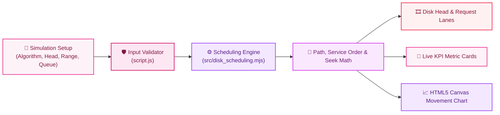

<div align="center">

<!-- Animated Soft Pink & Lavender Wavy Banner -->


<!-- Animated Typing Subtitle -->
<a href="https://drishtijha.github.io/Drishti_Os_Mini_Project/">
  
</a>

<br/>

<!-- Aesthetic Pink & Pastel Badges -->
<p>
  <a href="https://drishtijha.github.io/Drishti_Os_Mini_Project/">
    
  </a>
  
  
  
</p>

<br/>

<!-- Aesthetic Divider -->


</div>

<br/>

## 🌸 About DiskLab

> *"Operating Systems concepts feel magical when you can watch every cylinder movement come alive!"* ✨

**DiskLab (Disk Scheduling Studio)** is an interactive **Operating Systems Mini Project** crafted by **Drishti Jha**. Designed as a clean, modern visualization studio, it lets students and learners configure custom disk parameters, simulate **6 classic disk scheduling algorithms**, inspect per-request movement tracks, and analyze seek distance performance in real time.

<div align="center">

### 💖 Experience It Live
[**`🌷 https://drishtijha.github.io/Drishti_Os_Mini_Project/ 🌷`**](https://drishtijha.github.io/Drishti_Os_Mini_Project/)

</div>

<br/>

## ✨ Aesthetic & Functional Highlights

<table>
  <tr>
    <td width="50%" valign="top">
      <h3>🎀 Interactive Disk Head Simulator</h3>
      <p>Watch the read/write head glide smoothly across the cylinder scale with live coordinate indicators, tick marks, and an animated progress bar.</p>
    </td>
    <td width="50%" valign="top">
      <h3>🌷 Request-by-Request Lanes</h3>
      <p>Every queued I/O request gets its own dedicated mini-track showing source-to-target seek distance, target pin, and live status (<code>Waiting</code>, <code>Moving</code>, <code>Serviced</code>).</p>
    </td>
  </tr>
  <tr>
    <td width="50%" valign="top">
      <h3>📊 Real-Time Seek Metrics</h3>
      <p>Instant KPI cards calculate <b>Total Seek Distance</b>, <b>Requests Completed</b>, <b>Average Seek Distance</b>, and <b>Current Head Position</b> as the simulation runs.</p>
    </td>
    <td width="50%" valign="top">
      <h3>📈 Live Canvas Trajectory Graph</h3>
      <p>High-DPI HTML5 Canvas chart plots step-by-step cylinder traversal with gradient shading alongside a glowing serviced sequence trail.</p>
    </td>
  </tr>
  <tr>
    <td width="50%" valign="top">
      <h3>⏯️ Flexible Playback Controls</h3>
      <p>Play or pause at <code>0.5×</code>, <code>1×</code>, or <code>2×</code> speeds, step backward/forward one move at a time (<code>◀</code> / <code>▶|</code>), or reset anytime.</p>
    </td>
    <td width="50%" valign="top">
      <h3>🌓 Dark & Light Studio Modes</h3>
      <p>Includes a responsive workspace sidebar, random queue generator, input validation, and a one-click theme toggle (<code>◐</code>).</p>
    </td>
  </tr>
</table>

<br/>

## 🧠 Supported Scheduling Algorithms

Powered by `./src/disk_scheduling.mjs`, DiskLab supports **6 core OS disk scheduling policies**:

| ID | Algorithm | Full Name | How It Works | Boundary Style |
| :---: | :---: | :--- | :--- | :--- |
| `0` | **FCFS** | *First Come First Serve* | Services disk requests strictly in arrival order without reordering. | Moves directly in queue order |
| `1` | **SSTF** | *Shortest Seek Time First* | Greedily picks the pending request closest to the current head position. | Minimizes immediate seek distance |
| `2` | **SCAN** | *Elevator Algorithm* | Sweeps in the initial direction servicing requests along the way, then reverses. | Travels all the way to disk edge |
| `3` | **C-SCAN** | *Circular SCAN* | Sweeps in one direction to the boundary, then circularly returns to the start. | Touches both disk boundaries |
| `4` | **LOOK** | *Improved SCAN* | Sweeps in the chosen direction only up to the last pending request, then reverses. | Reverses at extreme request |
| `5` | **C-LOOK** | *Circular LOOK* | Services requests up to the extreme request, then jumps circularly to the other end. | Circular jump between extremes |

<br/>

## 🦋 How DiskLab Works



### 📂 Repository Structure

```text
Drishti_Os_Mini_Project/
├── 📄 index.html               # Workspace layout, simulator, analytics & algorithm cards
├── 🎨 style.css                # Theme variables, orbital hero artwork, tracks & responsive grids
├── ⚡ script.js                # State management, validation, playback timer & Canvas renderer
└── 📁 src/
    └── 🧩 disk_scheduling.mjs  # Disk scheduling engine computing path, service order & seek distance
```

<br/>

## 🌷 Default Benchmark Preset

DiskLab starts ready with a classic OS textbook example so you can test and compare every algorithm right away:

| Parameter | Default Value | Description |
| :--- | :---: | :--- |
| **Initial Head Position** | `53` | Starting cylinder coordinate (`diskMin ≤ head ≤ diskMax`) |
| **Cylinder Range** | `0` — `199` | Customizable minimum and maximum cylinder limits |
| **Initial Direction** | `Right →` (`1`) | Choose between `Right →` (`1`) and `Left ←` (`-1`) |
| **Request Queue** | `98, 183, 37, 122, 14, 124, 65, 67` | Supports custom CSV lists (up to `1,000` requests) or random generation |

<br/>

## 🚀 Run Locally

Because **DiskLab** uses ES Modules (`<script type="module">`), serve it with any local HTTP server:

```bash
# 1. Clone Drishti's repository
git clone https://github.com/drishtijha/Drishti_Os_Mini_Project.git

# 2. Navigate into the project folder
cd Drishti_Os_Mini_Project

# 3. Launch a local server (Python 3 or VS Code Live Server)
python -m http.server 8080
```

Then visit **`http://localhost:8080`** in your browser and click **Analyze Scheduling →** ✨

<br/>

<div align="center">


### Made with 💖 by **Drishti Jha**
*Operating Systems Mini Project • DiskLab © 2026*


</div>
